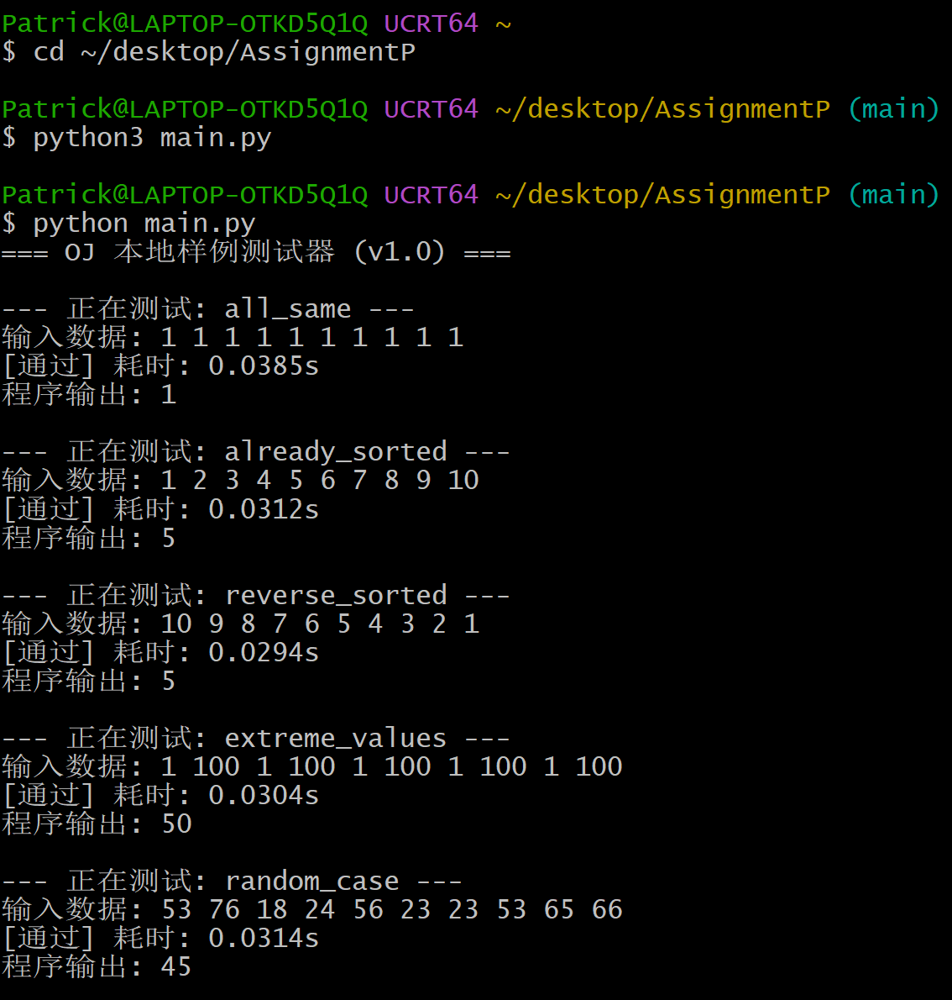

# OJ 本地样例测试器（OJ Local Sample Tester）

面向大一计概学生自己的本地判题辅助工具：OJ 上 WA 了只有冷冰冰的提示、看不到输入数据；本地 IDE 有报错却没有极限样例。本项目让你在本地自动生成测试数据、运行自己的代码、捕获超时与运行时错误，不用再对着 WA 抓瞎。

## 一、项目背景与目标

- **面向谁**：正在上计算概论、被 OJ 判题困扰的同学（第一用户就是作者本人）。
- **解决什么问题**：OJ 判 WA 时看不到输入数据和报错细节；本地手造测试数据又慢又覆盖不到边界情况。
- **已完成功能（V1.0）**：
  1. 生成指定范围的随机整数数组；
  2. 自动生成 4 类边界用例：全相同、升序、降序、极值交替；
  3. 自动运行待测代码并计时，判定三类状态：正常完成 / RE（运行时错误）/ TLE（2 秒超时）；
  4. 一次批量跑多组用例，逐组打印输入、状态、耗时与输出。

## 二、课程知识与核心设计

- **数据结构**：用 `list` 存储数组数据；用 `dict` 把用例名映射到用例数据（`{"all_same": [...], ...}`），便于按名遍历和扩展。
- **进程隔离（关键设计）**：用 `subprocess` 启动一个独立 Python 进程运行待测代码，而不是直接 `import` 调用。取舍：直接调用更快，但被测评代码一旦死循环或崩溃，会把测试器一起拖垮；独立进程能通过**退出码**判定 RE、通过**超时**判定 TLE——OJ一般的体验（）
- **计时**：`time.time()` 在子进程运行前后取差值。
- **复杂度**：`generate_array` 与 `generate_edge_cases` 均为 O(n)；单组测试的额外开销为常数，耗时瓶颈在待测代码自身。
- **列表推导式**：`[random.randint(...) for _ in range(n)]` 一行生成随机数组，比 for 循环逐个 append 更简洁。

## 三、安装与运行

- **环境**：Python 3.x。只使用标准库 `random` / `subprocess` / `time` / `sys`，无任何第三方依赖。
- **启动**：在项目根目录执行

  ```bash
  python main.py
  ```

- **项目结构**：

  ```text
  AssignmentP/
  ├── main.py               # 程序入口：生成数据 → 运行 → 打印结果
  ├── src/
  │   ├── __init__.py       # 空文件，标记 src 是 Python 包
  │   ├── generator.py      # 数据生成器（DataGenerator 类）
  │   └── runner.py         # 代码运行器（CodeRunner 类）
  ├── docs/
  │   └── screenshot.png    # 运行截图
  ├── examples/
  │   └── demo_solution.py  # 示例"待测代码"（求平均值）
  └── README.md
  ```

- **自定义测试**：改 `main.py` 顶部的 `N` 调数据规模；改 `DataGenerator(min_val=..., max_val=...)` 调数据范围；把 `CodeRunner("路径")` 换成你自己的代码文件即可测试。

## 四、功能展示



示例输出（N=10，范围 1~100）：

```text
=== OJ 本地样例测试器 (v1.0) ===

--- 正在测试: all_same ---
输入数据: 1 1 1 1 1 1 1 1 1 1
[通过] 耗时: 0.0456s
程序输出: 1

--- 正在测试: already_sorted ---
输入数据: 1 2 3 4 5 6 7 8 9 10
[通过] 耗时: 0.0304s
程序输出: 5

--- 正在测试: reverse_sorted ---
输入数据: 10 9 8 7 6 5 4 3 2 1
[通过] 耗时: 0.0302s
程序输出: 5

--- 正在测试: extreme_values ---
输入数据: 1 100 1 100 1 100 1 100 1 100
[通过] 耗时: 0.0303s
程序输出: 50

--- 正在测试: random_case ---
输入数据: 41 41 79 60 74 33 11 9 85 13
[通过] 耗时: 0.0299s
程序输出: 44
```

## 五、测试与结果

5 组用例（N=10，范围 1~100）实测，平均值（取整）均与手算一致：

| 用例 | 数据 | 期望输出 | 实际输出 | 结果 |
| :--- | :--- | :--- | :--- | :--- |
| all_same | 10 个 1 | 1 | 1 | ✓ |
| already_sorted | 1~10 | 5 | 5 | ✓ |
| reverse_sorted | 10~1 | 5 | 5 | ✓ |
| extreme_values | 1、100 交替 | 50 | 50 | ✓ |
| random_case | 随机数组 | 手算 44 | 44 | ✓ |

边界说明：demo 对空输入有防御分支（直接返回，不崩溃）。RE 与 TLE 两条判定路径尚未用真实坏代码实测，列为待验证项。

## 六、局限与改进

- 目前只覆盖"一行整数数组"类题型；多行、多组、字符串等题型待扩展。
- 尚无 **WA 检测（对拍）**：V1.2 计划加入"暴力正确解法"对比，输出不一致自动报 WA 并指出出错用例——这是核心痛点功能。
- 尚无内存监控（MLE）与复杂度自动分析：V1.5/V2.0 计划（N=100/1000/10000 多档计时，估算 O(N) / O(N²)）。
- 超时阈值固定 2 秒，后续改为命令行参数（argparse）。
- 已添加 .gitignore 排除 `__pycache__` 缓存。

## 七、来源与 AI 使用声明

```text
使用工具：DeepSeek（对话式 AI，生成 V1.0 初版代码框架）；Qoder（本地编程 Agent，用于代码讲解、修改与调试）
参与环节：需求拆解、项目结构设计、生成 generator / runner / main / 示例代码初稿、本文档草稿
本人完成的设计、修改与判断：
  · 选题与需求定义（OJ 本地样例测试器）；
  .每个小功能末以#附上自己的收获与理解
验证方法及结果：Python 语法检查通过；运行 python main.py 得到 5 组用例结果，与手算期望值一致；RE/TLE 判定路径待后续用坏代码实测。
代表性协作案例或记录位置：DeepSeek 对话"大作业"；Qoder 会话开发记录。
引用与复用的外部资源：Python 标准库（random、subprocess、time、sys）；《课程大作业说明及评分标准》（Hongfei Yan，2026 fall）。
```
